### Preferences

1. [About](#about)
2. [Gameplay](#gameplay)
3. [Build and execution](#build-and-execution)
4. [In development](#in-development)


### About


Simple single-player the chess computer game is written in Java

All game actions such as: movement, check, checkmate, pawn promotion, castling, en passant are implemented.

This open-source project can be used for any purpose, university task, self-development, the base for more complex projects.

Pull requests or issues are welcome.


### Gameplay


*Chess board overview*

Topalov vs Kasparov 1999

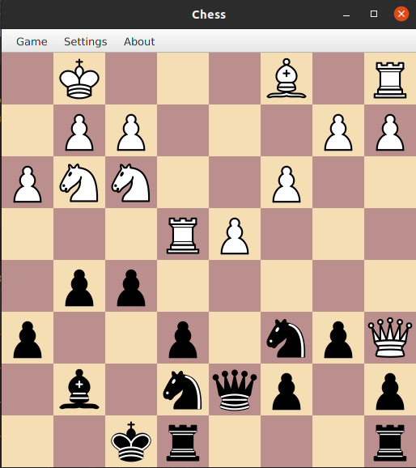

*Movement*

To move click on any piece then click where to move.

Be aware, you cannot move in case of check, only moves regarding to the game rules are possible.

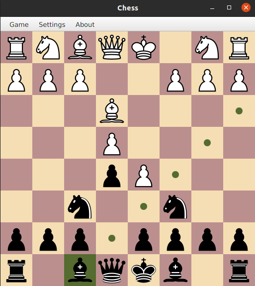

*Attack*

To attack click on an enemy piece

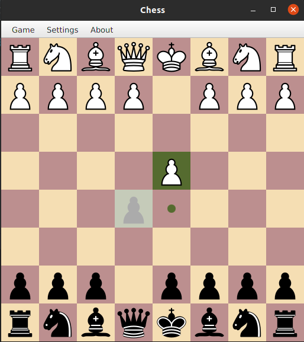

*Check*

If the king got a check, the player must avoid it.

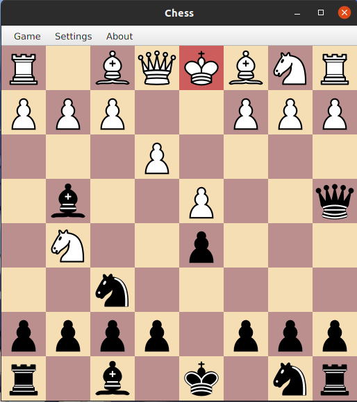

*Checkmate*

If the player could not avoid a check, it's checkmate, the finish of the game.

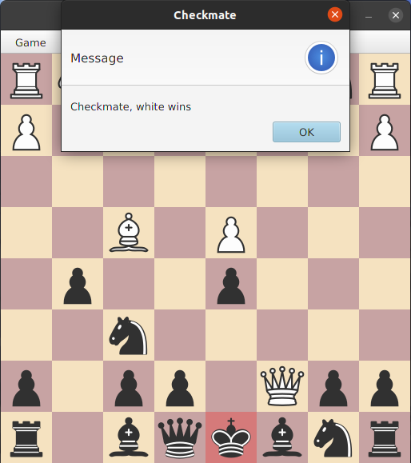


*Castling*

Castling can be performed when:

* The king piece has not moved yet.
* A Castling rock, has not moved yet.
* The castling path is not under attack.
* The king is not under check.

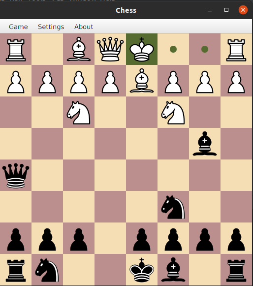

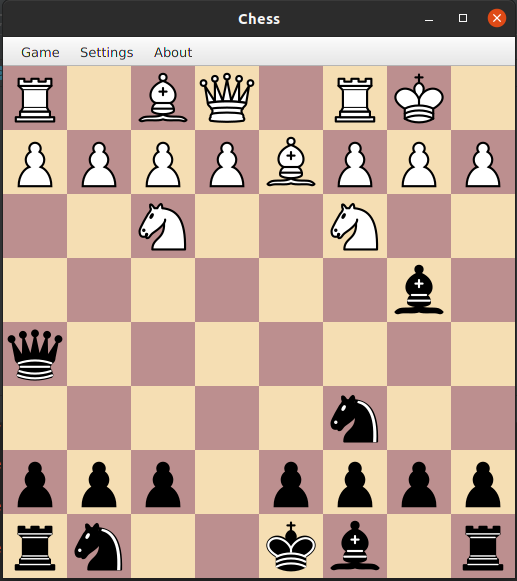

[More detailed](https://en.wikipedia.org/wiki/Castling)


*Pawn promotion*


The situation when a pawn achieves last rank on the desk.

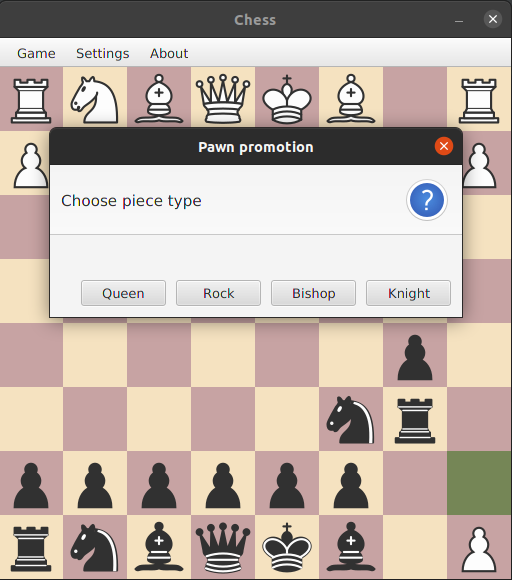

In that case, queen had been chosen.

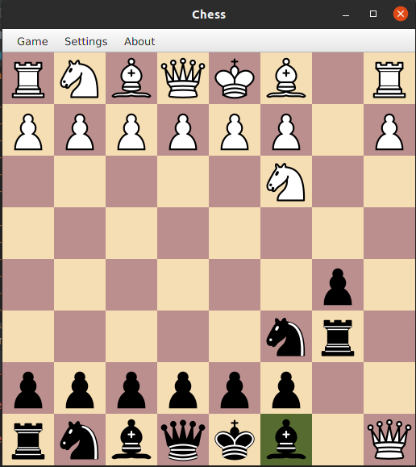

*En passant (in passing)*

The interesting situation when piece taking enemy pawn after its first move.
Only possible for pawns. If instead of passing the player moves other piece, passing will be lost

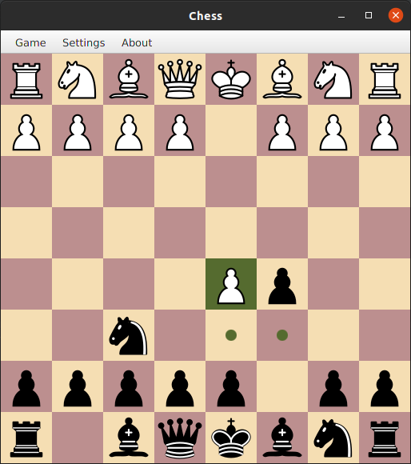

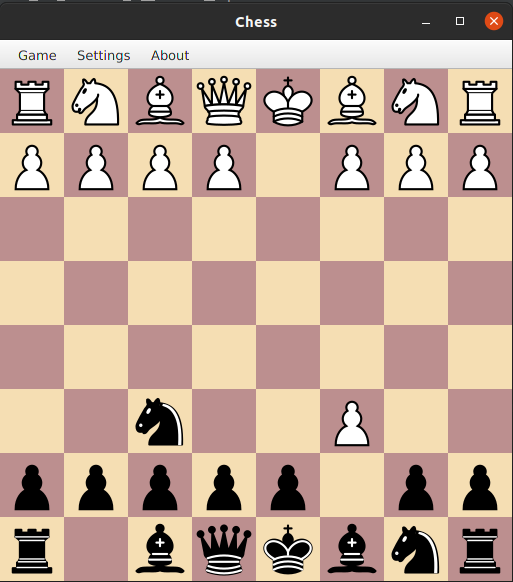

[More detailed](https://en.wikipedia.org/wiki/En_passant)


### Build and execution

#### Requirements

* Java 11+
* JavaFX SDK 11+

#### Build

See [Play against Codex](CODEX-PLAY.md) for the current Windows setup, build scripts, local two-player mode, and Codex bridge.


#### Console

JavaFX SDK downloads are excluded from this repository. Download the Windows x64 JavaFX SDK 11.0.2 from [Gluon](https://gluonhq.com/products/javafx/) and extract it to `sdk/javafx-windows/javafx-sdk-11.0.2`. The PowerShell launch script supplies these VM options:

```--module-path sdk/javafx-windows/javafx-sdk-11.0.2/lib --add-modules javafx.controls,jdk.httpserver```

### In development

* AI Player
* Step back/forward
* Board analyser
* Multiplayer via TCP
